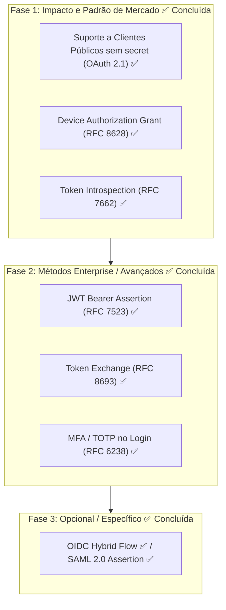
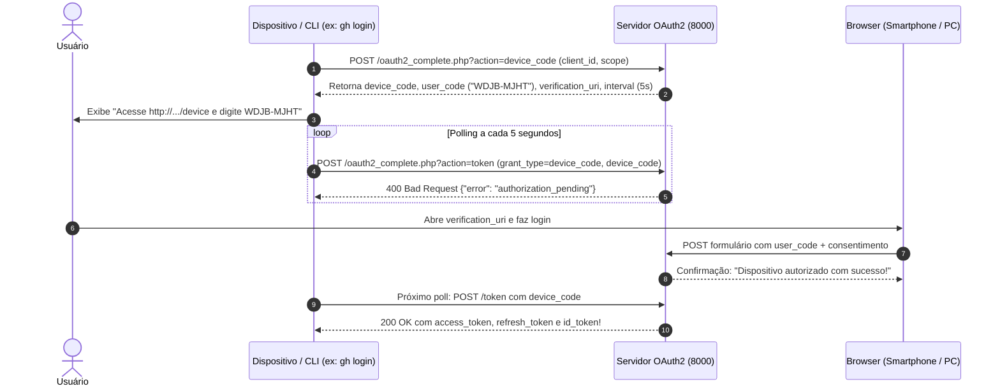

# Análise de Métodos de Autenticação e Plano de Evolução (OAuth 2.0 / 2.1)

**Projeto:** `php-oauth` (`server/oauth2_complete.php` e `client/oauth2_client.php`)  
**Data:** 17 de Outubro de 2026 (atualização)  
**Status:** Análise Técnica e Especificação de Mercado

---

## 1. Visão Geral: O Que Já Existe vs. O Que Falta

O ecossistema OAuth 2.0 / 2.1 e OpenID Connect define uma série de fluxos (*grants*), perfis e extensões projetados para diferentes arquiteturas de clientes e dispositivos.

### 1.1 Matriz de Status Atual no Projeto e no Mercado

| Método / Fluxo | Especificação | Presente no Projeto? | Status no Mercado Moderno | Recomendação de Uso Hoje |
| :--- | :--- | :---: | :---: | :--- |
| **Authorization Code + PKCE** | RFC 6749 + RFC 7636 | ✅ Sim | **Padrão Ouro Universal** | Obrigatório para Web Apps, SPAs e Mobile |
| **Client Credentials** | RFC 6749 §4.4 | ✅ Sim | **Padrão Ouro M2M** | Obrigatório para comunicação máquina-máquina / APIs |
| **Refresh Token** | RFC 6749 §6 | ✅ Sim | **Padrão Universal** | Essencial para renovação de sessão |
| **Token Revocation** | RFC 7009 | ✅ Sim | **Padrão da Indústria** | Padrão para logout e desautorização |
| **UserInfo & OIDC Discovery** | OIDC Core 1.0 | ✅ Sim | **Padrão Universal** | Padrão para federação de identidade e perfil |
| **Implicit Flow** | RFC 6749 §4.2 | ✅ Sim | ⚠️ **OBSOLETO / DEPRECATED** | **Proibido no OAuth 2.1**. Substituído por Auth Code + PKCE |
| **Password Flow (ROPC)** | RFC 6749 §4.3 | ✅ Sim | ⚠️ **OBSOLETO / DEPRECATED** | **Proibido no OAuth 2.1**. Viola o isolamento de credenciais |
| **Device Authorization Grant** | RFC 8628 | ✅ Sim | 🔥 **ALTAMENTE UTILIZADO** | Padrão para CLIs (`gh`, `aws`, `gcloud`) e Smart TVs |
| **Token Introspection** | RFC 7662 | ✅ Sim | 🔥 **PADRÃO DA INDÚSTRIA** | Essencial para APIs/Resource Servers com tokens opacos |
| **Public Clients (PKCE sem secret)** | OAuth 2.1 / RFC 7636 | ✅ Sim | 🔥 **PADRÃO OBRIGATÓRIO** | SPAs e Apps Mobile não devem ter `client_secret` |
| **JWT Bearer Assertion** | RFC 7523 | ✅ Sim | 💼 **MUITO UTILIZADO (Enterprise)** | Padrão de Service Accounts (Google Cloud, Salesforce) |
| **Token Exchange** | RFC 8693 | ✅ Sim | 🏢 **MÉDIO/ENTERPRISE** | Usado em malhas de microsserviços / delegação |
| **OIDC Hybrid Flow** | OIDC Core 1.0 | ✅ Sim | ⏳ **EM DECLÍNIO** | Pouco usado em novos projetos; superado por Code + PKCE |
| **SAML 2.0 Assertion** | RFC 7522 | ✅ Sim | 🏛️ **LEGADO CORPORATIVO** | Apenas para migração de SSO corporativo legado |
| **MFA / TOTP no Login** | RFC 6238 | ✅ Sim | 🔥 **PADRÃO UNIVERSAL** | Autenticação do usuário final com segundo fator |

---

## 2. Análise Detalhada dos Métodos Faltantes no Mercado

> [!NOTE]
> Device Authorization Grant (RFC 8628), Token Introspection (RFC 7662), Public Clients (OAuth 2.1), JWT Bearer Assertion (RFC 7523), Token Exchange (RFC 8693), OIDC Hybrid Flow, SAML 2.0 Assertion (RFC 7522) e MFA / TOTP (RFC 6238) **já foram implementados** e foram movidos para a seção 3.

### 2.1 OIDC Hybrid Flow (OIDC Core 1.0)
* **O que é:** Variante que retorna code e/ou tokens na primeira chamada de `/authorize` (fragmento ou query).
* **Ainda é utilizado no mercado?** **EM DECLÍNIO** — superado por Authorization Code + PKCE; mantido apenas por compatibilidade.

### 2.2 SAML 2.0 Assertion (RFC 7522)
* **O que é:** Permite autenticação de clientes mediante uma assertion SAML assinada, no lugar de `client_secret`.
* **Ainda é utilizado no mercado?** **LEGADO CORPORATIVO** — apenas para migração de SSO corporativo antigo.

### 2.3 MFA / TOTP no Login (RFC 6238)
* **O que é:** Segundo fator (código de 6 dígitos rotativo) exigido no momento da autenticação do usuário, antes da emissão do authorization code ou do token.
* **Ainda é utilizado no mercado?** **SIM, PADRÃO UNIVERSAL** — exigido por Google, GitHub, Microsoft e pela maioria das normas de segurança (NIST 800-63B).

---

## 3. Estado dos Métodos que o Projeto JÁ Possui

### 3.1 Métodos Implementados

| Método / Fluxo | Endpoint / Grant no Projeto | Documentação |
| :--- | :--- | :--- |
| Authorization Code + PKCE | `?action=authorize` → `?action=token` (`grant_type=authorization_code`, `code_verifier`) | `docs/IMPLEMENTACAO_AUTHORIZATION_CODE_FLOW.md` |
| Client Credentials | `grant_type=client_credentials` | `server/oauth2_complete.php` (painel `/debug`) |
| Refresh Token (com rotação) | `grant_type=refresh_token` | `server/oauth2_complete.php` |
| Token Revocation | `?action=revoke` (RFC 7009) | `server/oauth2_complete.php` |
| UserInfo & OIDC Discovery | `?action=userinfo`, `?action=well-known` | `server/oauth2_complete.php` |
| Implicit Flow ⚠️ | `response_type=token` | `docs/PLAN_IMPLICIT_FLOW.md` |
| Password Flow (ROPC) ⚠️ | `grant_type=password` | `server/oauth2_complete.php` |
| **Device Authorization Grant** ✅ *novo* | `?action=device_code`, `?action=device`, `grant_type=device_code` (RFC 8628) | `docs/DEVICE_AUTHORIZATION_GRANT.md` |
| **Token Introspection** ✅ *novo* | `?action=introspect` (RFC 7662) | `docs/TOKEN_INTROSPECTION.md` |
| **Public Clients (PKCE sem secret)** ✅ *novo* | `isPublicClient()` + cliente `spa_publica`; PKCE obrigatório no `/authorize`, `client_secret` dispensado no `/token` | `docs/IMPLEMENTACAO_PUBLIC_CLIENTS.md` |
| **JWT Bearer Assertion** ✅ *novo* | `grant_type=urn:ietf:params:oauth:grant-type:jwt-bearer` + `client_assertion` (RFC 7523) | `docs/PLAN_JWT_BEARER_ASSERTION.md` |
| **Token Exchange** ✅ *novo* | `grant_type=urn:ietf:params:oauth:grant-type:token-exchange` (`subject_token`/`actor_token`, RFC 8693) | `docs/PLAN_TOKEN_EXCHANGE.md` |
| **OIDC Hybrid Flow** ✅ *novo* | `response_type=code token` / `code id_token` / `code id_token token` no `/authorize` | `docs/PLAN_OIDC_HYBRID_FLOW.md` |
| **SAML 2.0 Assertion** ✅ *novo* | `grant_type=urn:ietf:params:oauth:grant-type:saml2-bearer` + `assertion` (RFC 7522) | `docs/PLAN_SAML2_ASSERTION.md` |
| **MFA / TOTP no Login** ✅ *novo* | Segundo fator no `/authorize` e no Device Flow; flag `'mfa' => true` por usuário (RFC 6238) | `docs/PLAN_MFA_TOTP.md` |

O cliente (`client/oauth2_client.php`) possui abas interativas para Authorization Code, Implicit, Password, Client Credentials, **Device Flow**, **JWT Bearer**, **Token Exchange**, **Hybrid Flow** e **SAML2 Bearer**. O MFA/TOTP é exigido no login interativo (Authorization Code / Hybrid) e no Device Flow para usuários com a flag `mfa`.

> [!WARNING]
> ### Alerta sobre Métodos Obsoletos Já Presentes no Código
> * **Implicit Flow (`response_type=token`):** Foi oficialmente **descontinuado (deprecated)** no OAuth 2.1 e pela BCP (RFC 9700). Tokens na URL sofrem riscos de vazamento em logs de proxy, histórico do navegador e headers `Referer`. No mercado moderno, SPAs devem usar **Authorization Code com PKCE**.
> * **Password Flow (`grant_type=password`):** Foi oficialmente **descontinuado (deprecated)** no OAuth 2.1. Nunca deve ser usado em projetos novos porque a aplicação cliente coleta as credenciais do usuário diretamente, violando o princípio de autorização delegada.

---

## 4. Proposta de Implementação (Roadmap Recomendado)

Caso deseje implementar novos métodos no projeto, propomos uma evolução modular e incremental:



---

## 5. Especificação Técnica das Fases

### 5.1 Componente Concluído: Device Authorization Grant (RFC 8628) ✅

> Implementado em `server/oauth2_complete.php` (`handleDeviceAuthorization()`, `handleDevice()` e `grant_type=device_code` em `handleToken()`) e na aba "📺 Device Flow" do `client/oauth2_client.php`. Detalhes em `docs/DEVICE_AUTHORIZATION_GRANT.md` e `docs/PLAN_DEVICE_AUTHORIZATION_GRANT.md`.



---

### 5.2 Componente Concluído: Token Introspection (RFC 7662) ✅

> Implementado em `server/oauth2_complete.php` (`handleIntrospect()`, rota `action=introspect`, anunciado no `?action=well-known`). Detalhes em `docs/TOKEN_INTROSPECTION.md`.

Um Resource Server (API) recebe `Authorization: Bearer <token>` e precisa saber se o token é válido:
```bash
POST /oauth2_complete.php?action=introspect
Authorization: Basic <client_id:client_secret>
Content-Type: application/x-www-form-urlencoded

token=7a91b...&token_type_hint=access_token
```

Resposta ativa:
```json
{
  "active": true,
  "scope": "openid profile email",
  "client_id": "cliente_teste",
  "sub": "usuario1",
  "exp": 1718000000,
  "token_type": "Bearer"
}
```

Resposta inativa ou expirada:
```json
{
  "active": false
}
```

---

### 5.3 Componente Concluído: Suporte a Clientes Públicos (Public Clients) ✅

> Implementado em `server/oauth2_complete.php`: helper `isPublicClient()` (aceita `'public' => true` ou `'client_secret' => null`), cliente de exemplo `spa_publica` (`token_endpoint_auth_method => none`), PKCE obrigatório no `/authorize` (`oauth2_complete.php:470`) e dispensa de `client_secret` no `/token` (`oauth2_complete.php:1006`). Detalhes em `docs/IMPLEMENTACAO_PUBLIC_CLIENTS.md`.

* Clientes públicos usam apenas `client_id` + PKCE (`code_verifier`), sem `client_secret`.
* O `/authorize` recusa autorização de cliente público sem `code_challenge`; o `/token` valida `code_verifier` via `verifyPkce()`.

---

### 5.4 Componente Concluído: JWT Bearer Assertion (RFC 7523) ✅

> Implementado em `server/oauth2_complete.php`: autenticação de cliente via `client_assertion_type=urn:ietf:params:oauth:client-assertion-type:jwt-bearer` (`verifyJwt()`), grant `urn:ietf:params:oauth:grant-type:jwt-bearer` em `handleToken()` (valida `iss`/`sub`, `aud` e escopo), `client_secret_jwt`/`private_key_jwt` anunciados no `?action=well-known` e aba "🔑 JWT Bearer" no cliente. Reimplementado após o revert `5ae4ef0`, agora integrado ao suporte a clientes públicos (`isPublicClient()`). Detalhes em `docs/PLAN_JWT_BEARER_ASSERTION.md`.

---

### 5.5 Componente Concluído: Token Exchange (RFC 8693) ✅

> Implementado em `server/oauth2_complete.php`: helpers `findOpaqueToken()` (busca o token opaco em `access_tokens`/`refresh_tokens`, respeitando a expiração) e `isScopeSubset()`; grant `urn:ietf:params:oauth:grant-type:token-exchange` em `handleToken()` (valida `subject_token`/`subject_token_type`, dono do token, `actor_token` para delegação, subset de `scope` e `audience` contra `allowed_audiences`); `issued_token_type` na resposta; `act`/`aud` expostos no `?action=introspect`; grant anunciado no `?action=well-known` e aba "🔄 Token Exchange" no cliente. Detalhes em `docs/PLAN_TOKEN_EXCHANGE.md`.

```mermaid
sequenceDiagram
    autonumber
    participant C as Cliente (microsserviço)
    participant S as Servidor OAuth2 (8000)

    C->>S: POST ?action=token (Basic Auth)
       grant_type=urn:ietf:params:oauth:grant-type:token-exchange
       subject_token=<AT do usuário>
       actor_token=<AT do serviço> (opcional, delegação)
       scope=openid (opcional, subset)
       audience=http://localhost:8000/api (opcional)
    S->>S: Valida subject_token/actor_token (ativos, mesmo client_id)
    S->>S: Valida subset de escopo e audiência permitida
    S-->>C: 200 {access_token, issued_token_type, token_type, expires_in, scope}
    Note over S: O subject_token NÃO é revogado (troca não destrutiva)
```

Requisição:
```bash
POST /oauth2_complete.php?action=token
Authorization: Basic <client_id:client_secret>
Content-Type: application/x-www-form-urlencoded

grant_type=urn:ietf:params:oauth:grant-type:token-exchange
&subject_token=<access_token>
&subject_token_type=urn:ietf:params:oauth:token-type:access_token
&scope=openid
```

Resposta:
```json
{
  "access_token": "9f3c...",
  "issued_token_type": "urn:ietf:params:oauth:token-type:access_token",
  "token_type": "Bearer",
  "expires_in": 3600,
  "scope": "openid"
}
```

---

### 5.6 Componente Implementado: OIDC Hybrid Flow (OIDC Core 1.0) ✅

> Implementado em `server/oauth2_complete.php`: `redirectWithError()` detecta fragmento para response_types com `token`/`id_token`; `handleAuthorize()` lê `response_mode` e exige `nonce` quando `id_token` presente; `completeAuthorization()` trata híbridos (`code token`, `code id_token`, `code id_token token`) gerando `code` em query + tokens em fragmento (default). Clientes `cliente_teste` e `spa_publica` atualizados com response_types híbridos. Aba "🔀 Hybrid Flow" adicionada ao `client/oauth2_client.php` com parsing de query+fragment e troca automática do `code` por token.

**Comportamento:**
- `code token` → `?code=XXX#access_token=YYY&token_type=Bearer&expires_in=3600&scope=...&state=...`
- `code id_token` (com nonce) → `?code=XXX#id_token=JWT&state=...`
- `code id_token token` → `?code=XXX#access_token=YYY&id_token=ZZZ&token_type=Bearer&expires_in=3600&scope=...&state=...`

O `code` gerado continua válido para troca via `grant_type=authorization_code` no token endpoint.

---

### 5.7 Componente Implementado: SAML 2.0 Assertion (RFC 7522) ✅

> Implementado em `server/oauth2_complete.php`: helpers `samlDecodeAssertion()`, `parseSamlAssertion()`, `validateSamlSignature()` (Enveloped RSA-SHA256 C14N), `validateSamlConditions()`, `validateSamlSubjectConfirmation()`, `validateSamlAssertion()` (validação completa RFC 7522), `extractPublicKeyFromCert()`. Grant `urn:ietf:params:oauth:grant-type:saml2-bearer` + client authentication via `client_assertion_type=saml2-bearer` em `handleToken()`. Cliente exemplo `cliente_saml` com `saml_trust` (issuers, audience, keys, clock_skew). Aba "🛡️ SAML2 Bearer" no `client/oauth2_client.php`. Detalhes em `docs/PLAN_SAML2_ASSERTION.md`.

**Validações RFC 7522:** Issuer confiável → Assinatura (RSA-SHA256, Enveloped, C14N) → Conditions (NotBefore/NotOnOrAfter + clock skew) → AudienceRestriction → SubjectConfirmation Bearer (Recipient = token endpoint, NotOnOrAfter) → Subject/NameID extraído para mapear usuário.

**Perfis suportados:**
- **Grant Type:** `grant_type=urn:ietf:params:oauth:grant-type:saml2-bearer&assertion=<SAML>`
- **Client Authentication:** `client_assertion_type=urn:ietf:params:oauth:client-assertion-type:saml2-bearer&client_assertion=<SAML>`

Assertion aceita XML bruto, Base64 ou Base64URL. Chave pública via X.509 (`-----BEGIN CERTIFICATE-----`) ou PEM público (`-----BEGIN PUBLIC KEY-----`).

### 5.8 Componente Implementado: MFA / TOTP no Login (RFC 6238) ✅

> Implementado em `server/oauth2_complete.php`: helpers `base32Encode()`/`base32Decode()` (RFC 4648), `generateTotpSecret()` (160 bits), `totpGenerate()` (HMAC-SHA1, 6 dígitos, período 30s), `totpVerify()` (janela ±1 passo, `hash_equals`), `totpOtpauthUri()` e `processTotpSubmission()` (máquina de estados compartilhada). Flag `'mfa' => true` no array `$users` (habilitada para `usuario1`). Formulários `showTotpForm()` (login interativo) e `showTotpFormForDevice()` (Device Flow). Utilitário CLI `server/totp_code.php`. Detalhes em `docs/PLAN_MFA_TOTP.md`.

**Máquina de estados (login interativo `/authorize` e Device Flow):**
1. Senha válida + usuário com `mfa` → se não há segredo, gera e exibe **enrollment** (segredo Base32 + URI `otpauth://`); se já há segredo, exibe formulário de verificação.
2. Código TOTP validado com janela de ±1 passo (tolerância de relógio).
3. **Replay protection:** o contador do período (30s) usado é gravado em `$storage['totp_used']` com TTL de 90s; reutilização é bloqueada.
4. **Rate limit:** máximo de 5 tentativas; ao exceder, volta ao login de senha.
5. Sucesso → `$_SESSION['oauth_authenticated_user']` é definido e o fluxo prossegue (consentimento / emissão de token).

**Storage:** `totp_secrets[$username] = ['secret' => '<base32>', 'created_at' => ts]` e `totp_used[$username][$counter] = ts`.

**Escopo:** login interativo do `/authorize` e login do Device Flow. O ROPC (`grant_type=password`) **não** exige TOTP (fora de escopo).

**Teste rápido:** `php server/totp_code.php usuario1` imprime o código TOTP atual (após o enrollment).

---

## 6. Plano de Verificação e Testes

### 6.1 Testes Automatizados (cURL / PHP CLI)

**Já cobertos (regressão):**
1. **Device Flow:** iniciar fluxo via cURL, receber `authorization_pending` no polling, aprovar e validar a entrega do `access_token`.
2. **Introspection:** token recém-criado retorna `active === true`; após `?action=revoke`, retorna `active === false`.
3. **Public Client:** Authorization Code Flow com PKCE usando `spa_publica` **sem** `client_secret` retorna HTTP 200; sem `code_challenge` no `/authorize` retorna `invalid_request`.
4. **JWT Bearer:** enviar `assertion` JWT assinado e validar HTTP 200; JWT com `aud` incorreto/expirado deve retornar `invalid_grant`.
5. **Token Exchange:** trocar um `access_token` (subset de escopo) e validar `issued_token_type`; escopo maior retorna `invalid_scope`; `actor_token` inválido retorna `invalid_grant`; `audience` não permitida retorna `invalid_target`; o `subject_token` original permanece válido.

**Pendentes (novos métodos):**
6. **Hybrid Flow (OIDC):**
   * `code token` retorna `code` em query + `access_token` em fragmento
   * `code id_token` com `nonce` retorna `code` em query + `id_token` em fragmento
   * `code id_token token` com `nonce` retorna code + tokens conforme esperado
   * `code id_token` sem `nonce` retorna `error=invalid_request`
   * `code` gerado em híbrido pode ser trocado com sucesso no token endpoint

7. **SAML 2.0 Assertion (RFC 7522):**
   * Assertion válida (assinada, prazos OK, Recipient/Audience OK) retorna 200 + access_token
   * Assinatura inválida retorna `400 invalid_grant`
   * Expirada (NotOnOrAfter < agora) retorna `400 invalid_grant`
   * NotBefore futuro retorna `400 invalid_grant`
   * Audience incorreto retorna `400 invalid_grant`
   * Recipient incorreto retorna `400 invalid_grant`
   * Issuer não confiável retorna `400 invalid_grant`
   * Assinatura inválida retorna `400 invalid_grant`
   * Expirada (NotOnOrAfter < agora) retorna `400 invalid_grant`
   * NotBefore futuro retorna `400 invalid_grant`
   * Audience incorreto retorna `400 invalid_grant`
   * Recipient incorreto retorna `400 invalid_grant`
   * Issuer não confiável retorna `400 invalid_grant`

8. **MFA / TOTP (RFC 6238):**
   * `usuario2` (sem flag `mfa`) segue o fluxo normal, sem TOTP
   * `usuario1` no 1º login exibe enrollment (segredo Base32 + URI `otpauth://`); código válido persiste o segredo e conclui o login
   * Login subsequente de `usuario1` exige TOTP (sem enrollment)
   * Código inválido é rejeitado; reutilização do mesmo código (mesmo período) é bloqueada
   * Após 5 tentativas inválidas, volta ao login de senha
   * `prompt=none` com sessão em MFA pendente retorna `interaction_required`
   * Device Flow com `usuario1` exige TOTP (enrollment + verificação) antes do consentimento
   * `totpGenerate()` confere com implementação de referência (RFC 6238) em timestamps fixos
   * Algoritmo não suportado retorna `400 invalid_grant`
   * XML mal formado retorna `400 invalid_grant`
   * Sem assinatura retorna `400 invalid_grant`

8. **MFA / TOTP:**
   * Login com código TOTP válido aprova; código inválido/expirado é rejeitado; reutilização do mesmo código é bloqueada.

### 6.2 Testes Manuais
* Abrir `http://localhost:8001/oauth2_client.php` na aba **Device Flow**: ver o código na tela simulando uma CLI, abrir a URL no navegador, aprovar e observar a CLI receber o token automaticamente.
* Abrir a aba **JWT Bearer**, gerar o JWT e solicitar o token.
* Abrir a aba **Token Exchange**, colar um `access_token` obtido em outro flow, informar um `scope` menor (ex.: `openid`) e solicitar o token.
* Testar `?action=introspect` com um token ativo e outro revogado.
* Abrir a aba **Hybrid Flow**, testar `code token`, `code id_token` (com nonce) e `code id_token token`. Verificar que `code` é trocado automaticamente e tokens aparecem na sessão.
* Abrir a aba **SAML2 Bearer**, gerar SAML de teste (didático) ou colar assertion assinada real, testar modos Grant Type e Client Authentication.
* **MFA / TOTP:** fazer login com `usuario1`/`senha123` no `/authorize`; na primeira vez, configurar o segredo no app autenticador (ou usar `php server/totp_code.php usuario1`) e informar o código. Repetir o login para validar a verificação. Testar também no Device Flow.
* Testar o cliente público `spa_publica` (fluxo Authorization Code com PKCE, sem `client_secret`).

