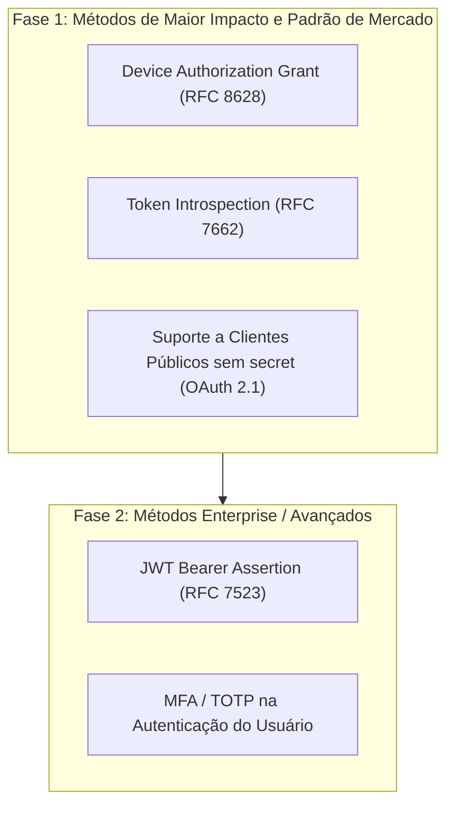
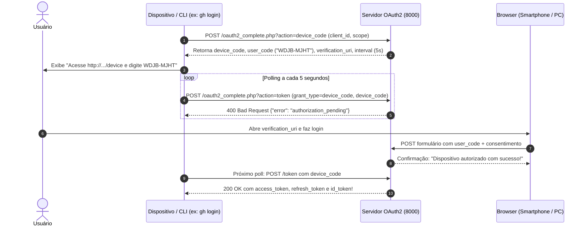

# Análise de Métodos de Autenticação e Plano de Evolução (OAuth 2.0 / 2.1)

**Projeto:** `php-oauth` (`server/oauth2_complete.php` e `client/oauth2_client.php`)  
**Data:** 12 de Outubro de 2026  
**Status:** Análise Técnica e Especificação de Mercado

---

## 1. Visão Geral: O Que Já Existe vs. O Que Falta

O ecossistema OAuth 2.0 / 2.1 e OpenID Connect define uma série de fluxos (*grants*), perfis e extensões projetados para diferentes arquiteturas de clientes e dispositivos.

### 1.1 Matriz de Status Atual no Projeto e no Mercado

| Método / Fluxo | Especificação | Presente no Projeto? | Status no Mercado Moderno | Recomendação de Uso Hoje |
| :--- | :--- | :---: | :---: | :--- |
| **Authorization Code + PKCE** | RFC 6749 + RFC 7636 | ✅ Sim | **Padrão Ouro Universal** | Obrigatório para Web Apps, SPAs e Mobile |
| **Client Credentials** | RFC 6749 §4.4 | ✅ Sim | **Padrão Ouro M2M** | Obrigatório para comunicação máquina-máquina / APIs |
| **Refresh Token** | RFC 6749 §6 | ✅ Sim | **Padrão Universal** | Essencial para renovação de sessão |
| **Token Revocation** | RFC 7009 | ✅ Sim | **Padrão da Indústria** | Padrão para logout e desautorização |
| **UserInfo & OIDC Discovery** | OIDC Core 1.0 | ✅ Sim | **Padrão Universal** | Padrão para federação de identidade e perfil |
| **Implicit Flow** | RFC 6749 §4.2 | ✅ Sim | ⚠️ **OBSOLETO / DEPRECATED** | **Proibido no OAuth 2.1**. Substituído por Auth Code + PKCE |
| **Password Flow (ROPC)** | RFC 6749 §4.3 | ✅ Sim | ⚠️ **OBSOLETO / DEPRECATED** | **Proibido no OAuth 2.1**. Viola o isolamento de credenciais |
| **Device Authorization Grant** | RFC 8628 | ✅ Sim | 🔥 **ALTAMENTE UTILIZADO** | Padrão para CLIs (`gh`, `aws`, `gcloud`) e Smart TVs |
| **Token Introspection** | RFC 7662 | ✅ Sim | 🔥 **PADRÃO DA INDÚSTRIA** | Essencial para APIs/Resource Servers com tokens opacos |
| **Public Clients (PKCE sem secret)** | OAuth 2.1 / RFC 7636 | ❌ **Falta** | 🔥 **PADRÃO OBRIGATÓRIO** | SPAs e Apps Mobile não devem ter `client_secret` |
| **JWT Bearer Assertion** | RFC 7523 | ❌ **Falta** | 💼 **MUITO UTILIZADO (Enterprise)** | Padrão de Service Accounts (Google Cloud, Salesforce) |
| **Token Exchange** | RFC 8693 | ❌ **Falta** | 🏢 **MÉDIO/ENTERPRISE** | Usado em malhas de microsserviços / delegação |
| **OIDC Hybrid Flow** | OIDC Core 1.0 | ❌ **Falta** | ⏳ **EM DECLÍNIO** | Pouco usado em novos projetos; superado por Code + PKCE |
| **SAML 2.0 Assertion** | RFC 7522 | ❌ **Falta** | 🏛️ **LEGADO CORPORATIVO** | Apenas para migração de SSO corporativo legado |
| **MFA / TOTP no Login** | RFC 6238 | ❌ **Falta** | 🔥 **PADRÃO UNIVERSAL** | Autenticação do usuário final com segundo fator |

---

## 2. Análise Detalhada dos Métodos Faltantes no Mercado

### 2.1 Device Authorization Grant (RFC 8628 - "Device Flow")
* **O que é:** Criado para dispositivos sem navegador integrado ou com entrada de texto restrita. O dispositivo solicita um código e recebe um `device_code` e um `user_code` curto (ex: `ABCD-1234`), exibindo uma URL (`/device`) para o usuário acessar no smartphone ou computador. Enquanto o usuário digita o código e autoriza na web, o dispositivo faz requisições periódicas (*polling*) até receber os tokens.
* **Ainda é utilizado no mercado?** **SIM, MASSIVAMENTE!**
  * **CLIs de Desenvolvedores:** `gh auth login` (GitHub CLI), `aws login`, `gcloud auth login` (Google Cloud SDK), `docker login`, `vercel login`, `supabase login`, `stripe login`.
  * **Dispositivos Conectados:** YouTube e Netflix em Smart TVs, Spotify Connect, consoles de videogame (PlayStation, Xbox), Apple TV e IoT.
* **Relevância para o projeto:** É a adição mais rica, moderna e didática que pode ser feita no `php-oauth`.

### 2.2 Token Introspection (RFC 7662 - `/introspect`)
* **O que é:** Um endpoint protegido onde um Resource Server (uma API que protege dados) consulta se um determinado token recebido no header `Authorization: Bearer <token>` ainda está ativo e quais são seus metadados (`active`, `scope`, `client_id`, `sub`, `exp`).
* **Ainda é utilizado no mercado?** **SIM, É O PADRÃO DA INDÚSTRIA.**
  * Como este projeto emite **tokens opacos** (strings hexadecimais aleatórias de 64 caracteres em vez de JWTs assinados para access token), as APIs externas não conseguem validar o token sozinhas sem consultar o servidor de autorização. O endpoint `/introspect` é suportado em todas as soluções de mercado (Keycloak, Auth0, Okta, Hydra).

### 2.3 Suporte a Clientes Públicos (Public Clients com PKCE sem `client_secret`)
* **O que é:** O servidor atual do projeto (`oauth2_complete.php:939`) rejeita chamadas ao `/token` se o `client_secret` não for fornecido ou estiver incorreto. No entanto, por definição da especificação OAuth, **clientes públicos** (Single Page Apps em React/Vue e Aplicativos Mobile em iOS/Android/Flutter) rodam no ambiente do usuário e **não podem manter um segredo seguro**.
* **Ainda é utilizado no mercado?** **SIM! É A REGRA FUNDAMENTAL DO OAUTH MODERNO (OAuth 2.1).** Clientes públicos devem usar `client_id` + PKCE (`code_verifier`), sem nenhum `client_secret`.

### 2.4 JWT Bearer Token Grant (RFC 7523 - Service Accounts)
* **O que é:** Um fluxo machine-to-machine onde o cliente não envia uma senha fixa (`client_secret`), mas sim um JWT assinado com uma chave privada RSA/ECDSA gerada pelo próprio cliente.
* **Ainda é utilizado no mercado?** **SIM, MUITO UTILIZADO EM NUVEM E ENTERPRISE.**
  * É a base de autenticação das contas de serviço do Google Cloud (Service Account JSON) e integrações corporativas com Salesforce, AWS STS e Box.

---

## 3. Estado dos Métodos que o Projeto JÁ Possui

> [!WARNING]
> ### Alerta sobre Métodos Obsoletos Já Presentes no Código
> * **Implicit Flow (`response_type=token`):** Foi oficialmente **descontinuado (deprecated)** no OAuth 2.1 e pela BCP (RFC 9700). Tokens na URL sofrem riscos de vazamento em logs de proxy, histórico do navegador e headers `Referer`. No mercado moderno, SPAs devem usar **Authorization Code com PKCE**.
> * **Password Flow (`grant_type=password`):** Foi oficialmente **descontinuado (deprecated)** no OAuth 2.1. Nunca deve ser usado em projetos novos porque a aplicação cliente coleta as credenciais do usuário diretamente, violando o princípio de autorização delegada.

---

## 4. Proposta de Implementação (Roadmap Recomendado)

Caso deseje implementar novos métodos no projeto, propomos uma evolução modular e incremental:



---

## 5. Especificação Técnica da Fase 1 (Recomendada)

### 5.1 Componente A: Device Authorization Grant (RFC 8628)

#### Fluxo Operacional:


#### Arquivos a Modificar:
* `server/oauth2_complete.php`:
  * Novo endpoint `action=device_code`: gera `device_code`, `user_code` de 8 caracteres legíveis (ex: `BCDF-GHJK`), armazena em `$storage['device_codes']`.
  * Novo endpoint `action=device`: tela HTML onde o usuário digita o `user_code`, visualiza os escopos solicitados pelo cliente e clica em autorizar.
  * Suporte em `handleToken()` para `grant_type=urn:ietf:params:oauth:grant-type:device_code`. Responde `authorization_pending`, `slow_down` ou entrega tokens.
* `client/oauth2_client.php`:
  * Nova aba "📺 Device Flow (CLI / TV)", simulando a tela de um terminal CLI ou Smart TV fazendo o polling em tempo real via JavaScript/Fetch.

---

### 5.2 Componente B: Token Introspection (RFC 7662)

#### Fluxo Operacional:
Um Resource Server (API) recebe `Authorization: Bearer <token>` e precisa saber se o token é válido:
```bash
POST /oauth2_complete.php?action=introspect
Authorization: Basic <client_id:client_secret>
Content-Type: application/x-www-form-urlencoded

token=7a91b...&token_type_hint=access_token
```

Resposta ativa:
```json
{
  "active": true,
  "scope": "openid profile email",
  "client_id": "cliente_teste",
  "sub": "usuario1",
  "exp": 1718000000,
  "token_type": "Bearer"
}
```

Resposta inativa ou expirada:
```json
{
  "active": false
}
```

---

### 5.3 Componente C: Suporte a Clientes Públicos (Public Clients)

* Permitir clientes no `$clients` com `'public' => true` ou `'client_secret' => null`.
* No endpoint `/token`, se o cliente for público e estiver usando `grant_type=authorization_code`, **dispensar a verificação de `client_secret`**, exigindo estritamente a validação do `code_verifier` (PKCE com método `S256`).

---

## 6. Plano de Verificação e Testes

### 6.1 Testes Automatizados (cURL / PHP CLI)
1. **Device Flow:**
   * Iniciar fluxo via cURL e obter `device_code` e `user_code`.
   * Testar polling recebendo `authorization_pending`.
   * Aprovar via requisição simulada e validar se o próximo polling recebe `access_token`.
2. **Introspection:**
   * Testar token recém-criado: verificar `active === true`.
   * Revogar token e testar introspection: verificar `active === false`.
3. **Public Client:**
   * Executar Authorization Code Flow com PKCE usando cliente público sem enviar `client_secret`: deve aprovar com HTTP 200.

### 6.2 Testes Manuais
* Abrir `http://localhost:8001/oauth2_client.php` na aba **Device Flow**.
* Ver o código na tela simulando uma CLI, abrir a URL no navegador, aprovar e observar a CLI receber o token automaticamente.

