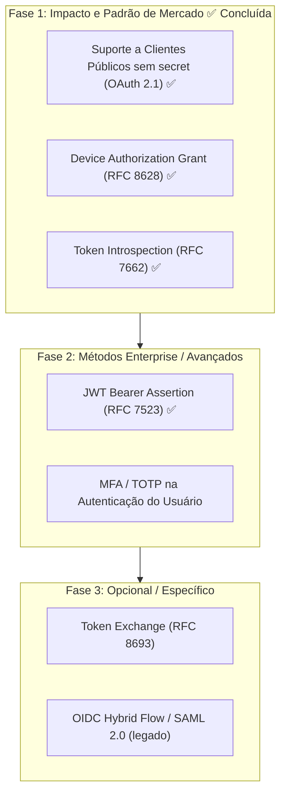
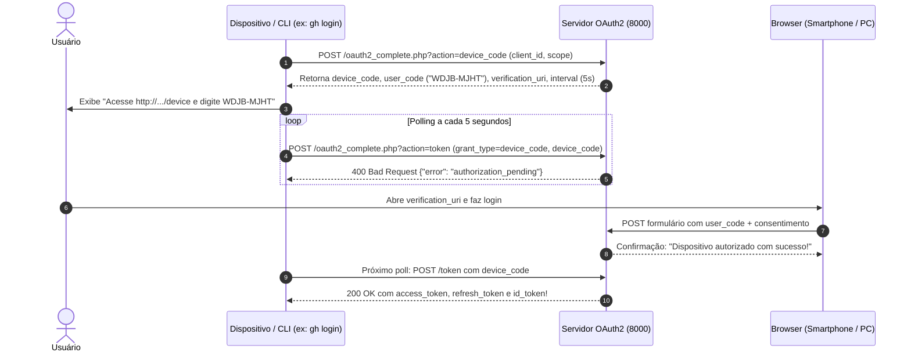

# Análise de Métodos de Autenticação e Plano de Evolução (OAuth 2.0 / 2.1)

**Projeto:** `php-oauth` (`server/oauth2_complete.php` e `client/oauth2_client.php`)  
**Data:** 17 de Outubro de 2026 (atualização)  
**Status:** Análise Técnica e Especificação de Mercado

---

## 1. Visão Geral: O Que Já Existe vs. O Que Falta

O ecossistema OAuth 2.0 / 2.1 e OpenID Connect define uma série de fluxos (*grants*), perfis e extensões projetados para diferentes arquiteturas de clientes e dispositivos.

### 1.1 Matriz de Status Atual no Projeto e no Mercado

| Método / Fluxo | Especificação | Presente no Projeto? | Status no Mercado Moderno | Recomendação de Uso Hoje |
| :--- | :--- | :---: | :---: | :--- |
| **Authorization Code + PKCE** | RFC 6749 + RFC 7636 | ✅ Sim | **Padrão Ouro Universal** | Obrigatório para Web Apps, SPAs e Mobile |
| **Client Credentials** | RFC 6749 §4.4 | ✅ Sim | **Padrão Ouro M2M** | Obrigatório para comunicação máquina-máquina / APIs |
| **Refresh Token** | RFC 6749 §6 | ✅ Sim | **Padrão Universal** | Essencial para renovação de sessão |
| **Token Revocation** | RFC 7009 | ✅ Sim | **Padrão da Indústria** | Padrão para logout e desautorização |
| **UserInfo & OIDC Discovery** | OIDC Core 1.0 | ✅ Sim | **Padrão Universal** | Padrão para federação de identidade e perfil |
| **Implicit Flow** | RFC 6749 §4.2 | ✅ Sim | ⚠️ **OBSOLETO / DEPRECATED** | **Proibido no OAuth 2.1**. Substituído por Auth Code + PKCE |
| **Password Flow (ROPC)** | RFC 6749 §4.3 | ✅ Sim | ⚠️ **OBSOLETO / DEPRECATED** | **Proibido no OAuth 2.1**. Viola o isolamento de credenciais |
| **Device Authorization Grant** | RFC 8628 | ✅ Sim | 🔥 **ALTAMENTE UTILIZADO** | Padrão para CLIs (`gh`, `aws`, `gcloud`) e Smart TVs |
| **Token Introspection** | RFC 7662 | ✅ Sim | 🔥 **PADRÃO DA INDÚSTRIA** | Essencial para APIs/Resource Servers com tokens opacos |
| **Public Clients (PKCE sem secret)** | OAuth 2.1 / RFC 7636 | ✅ Sim | 🔥 **PADRÃO OBRIGATÓRIO** | SPAs e Apps Mobile não devem ter `client_secret` |
| **JWT Bearer Assertion** | RFC 7523 | ✅ Sim | 💼 **MUITO UTILIZADO (Enterprise)** | Padrão de Service Accounts (Google Cloud, Salesforce) |
| **Token Exchange** | RFC 8693 | ❌ **Falta** | 🏢 **MÉDIO/ENTERPRISE** | Usado em malhas de microsserviços / delegação |
| **OIDC Hybrid Flow** | OIDC Core 1.0 | ❌ **Falta** | ⏳ **EM DECLÍNIO** | Pouco usado em novos projetos; superado por Code + PKCE |
| **SAML 2.0 Assertion** | RFC 7522 | ❌ **Falta** | 🏛️ **LEGADO CORPORATIVO** | Apenas para migração de SSO corporativo legado |
| **MFA / TOTP no Login** | RFC 6238 | ❌ **Falta** | 🔥 **PADRÃO UNIVERSAL** | Autenticação do usuário final com segundo fator |

---

## 2. Análise Detalhada dos Métodos Faltantes no Mercado

> [!NOTE]
> Device Authorization Grant (RFC 8628), Token Introspection (RFC 7662), Public Clients (OAuth 2.1) e JWT Bearer Assertion (RFC 7523) **já foram implementados** e foram movidos para a seção 3.

### 2.1 Token Exchange (RFC 8693)
* **O que é:** Permite a um serviço trocar um *access token* recebido por outro token com escopo/audiência diferentes, mantendo a identidade original (`subject`) ou atuando em nome de outro (*delegation*).
* **Ainda é utilizado no mercado?** **SIM, EM AMBIENTES ENTERPRISE / MICROSSERVIÇOS** (Kubernetes with SPIFFE/SPIRE, AWS, Google Cloud, Keycloak). Não é urgente para um projeto didático.

### 2.2 MFA / TOTP no Login (RFC 6238)
* **O que é:** Segundo fator (código de 6 dígitos rotativo) exigido no momento da autenticação do usuário, antes da emissão do authorization code ou do token.
* **Ainda é utilizado no mercado?** **SIM, PADRÃO UNIVERSAL** — exigido por Google, GitHub, Microsoft e pela maioria das normas de segurança (NIST 800-63B).

### 2.3 OIDC Hybrid Flow (OIDC Core 1.0)
* **O que é:** Variante que retorna code e/ou tokens na primeira chamada de `/authorize` (fragmento ou query).
* **Ainda é utilizado no mercado?** **EM DECLÍNIO** — superado por Authorization Code + PKCE; mantido apenas por compatibilidade.

### 2.4 SAML 2.0 Assertion (RFC 7522)
* **O que é:** Permite autenticação de clientes mediante uma assertion SAML assinada, no lugar de `client_secret`.
* **Ainda é utilizado no mercado?** **LEGADO CORPORATIVO** — apenas para migração de SSO corporativo antigo.

---

## 3. Estado dos Métodos que o Projeto JÁ Possui

### 3.1 Métodos Implementados

| Método / Fluxo | Endpoint / Grant no Projeto | Documentação |
| :--- | :--- | :--- |
| Authorization Code + PKCE | `?action=authorize` → `?action=token` (`grant_type=authorization_code`, `code_verifier`) | `docs/IMPLEMENTACAO_AUTHORIZATION_CODE_FLOW.md` |
| Client Credentials | `grant_type=client_credentials` | `server/oauth2_complete.php` (painel `/debug`) |
| Refresh Token (com rotação) | `grant_type=refresh_token` | `server/oauth2_complete.php` |
| Token Revocation | `?action=revoke` (RFC 7009) | `server/oauth2_complete.php` |
| UserInfo & OIDC Discovery | `?action=userinfo`, `?action=well-known` | `server/oauth2_complete.php` |
| Implicit Flow ⚠️ | `response_type=token` | `docs/PLAN_IMPLICIT_FLOW.md` |
| Password Flow (ROPC) ⚠️ | `grant_type=password` | `server/oauth2_complete.php` |
| **Device Authorization Grant** ✅ *novo* | `?action=device_code`, `?action=device`, `grant_type=device_code` (RFC 8628) | `docs/DEVICE_AUTHORIZATION_GRANT.md` |
| **Token Introspection** ✅ *novo* | `?action=introspect` (RFC 7662) | `docs/TOKEN_INTROSPECTION.md` |
| **Public Clients (PKCE sem secret)** ✅ *novo* | `isPublicClient()` + cliente `spa_publica`; PKCE obrigatório no `/authorize`, `client_secret` dispensado no `/token` | `docs/IMPLEMENTACAO_PUBLIC_CLIENTS.md` |
| **JWT Bearer Assertion** ✅ *novo* | `grant_type=urn:ietf:params:oauth:grant-type:jwt-bearer` + `client_assertion` (RFC 7523) | `docs/PLAN_JWT_BEARER_ASSERTION.md` |

O cliente (`client/oauth2_client.php`) possui abas interativas para Authorization Code, Implicit, Password, Client Credentials, **Device Flow** e **JWT Bearer**.

> [!WARNING]
> ### Alerta sobre Métodos Obsoletos Já Presentes no Código
> * **Implicit Flow (`response_type=token`):** Foi oficialmente **descontinuado (deprecated)** no OAuth 2.1 e pela BCP (RFC 9700). Tokens na URL sofrem riscos de vazamento em logs de proxy, histórico do navegador e headers `Referer`. No mercado moderno, SPAs devem usar **Authorization Code com PKCE**.
> * **Password Flow (`grant_type=password`):** Foi oficialmente **descontinuado (deprecated)** no OAuth 2.1. Nunca deve ser usado em projetos novos porque a aplicação cliente coleta as credenciais do usuário diretamente, violando o princípio de autorização delegada.

---

## 4. Proposta de Implementação (Roadmap Recomendado)

Caso deseje implementar novos métodos no projeto, propomos uma evolução modular e incremental:



---

## 5. Especificação Técnica das Fases

### 5.1 Componente Concluído: Device Authorization Grant (RFC 8628) ✅

> Implementado em `server/oauth2_complete.php` (`handleDeviceAuthorization()`, `handleDevice()` e `grant_type=device_code` em `handleToken()`) e na aba "📺 Device Flow" do `client/oauth2_client.php`. Detalhes em `docs/DEVICE_AUTHORIZATION_GRANT.md` e `docs/PLAN_DEVICE_AUTHORIZATION_GRANT.md`.



---

### 5.2 Componente Concluído: Token Introspection (RFC 7662) ✅

> Implementado em `server/oauth2_complete.php` (`handleIntrospect()`, rota `action=introspect`, anunciado no `?action=well-known`). Detalhes em `docs/TOKEN_INTROSPECTION.md`.

Um Resource Server (API) recebe `Authorization: Bearer <token>` e precisa saber se o token é válido:
```bash
POST /oauth2_complete.php?action=introspect
Authorization: Basic <client_id:client_secret>
Content-Type: application/x-www-form-urlencoded

token=7a91b...&token_type_hint=access_token
```

Resposta ativa:
```json
{
  "active": true,
  "scope": "openid profile email",
  "client_id": "cliente_teste",
  "sub": "usuario1",
  "exp": 1718000000,
  "token_type": "Bearer"
}
```

Resposta inativa ou expirada:
```json
{
  "active": false
}
```

---

### 5.3 Componente Concluído: Suporte a Clientes Públicos (Public Clients) ✅

> Implementado em `server/oauth2_complete.php`: helper `isPublicClient()` (aceita `'public' => true` ou `'client_secret' => null`), cliente de exemplo `spa_publica` (`token_endpoint_auth_method => none`), PKCE obrigatório no `/authorize` (`oauth2_complete.php:470`) e dispensa de `client_secret` no `/token` (`oauth2_complete.php:1006`). Detalhes em `docs/IMPLEMENTACAO_PUBLIC_CLIENTS.md`.

* Clientes públicos usam apenas `client_id` + PKCE (`code_verifier`), sem `client_secret`.
* O `/authorize` recusa autorização de cliente público sem `code_challenge`; o `/token` valida `code_verifier` via `verifyPkce()`.

---

### 5.4 Componente Concluído: JWT Bearer Assertion (RFC 7523) ✅

> Implementado em `server/oauth2_complete.php`: autenticação de cliente via `client_assertion_type=urn:ietf:params:oauth:client-assertion-type:jwt-bearer` (`verifyJwt()`), grant `urn:ietf:params:oauth:grant-type:jwt-bearer` em `handleToken()` (valida `iss`/`sub`, `aud` e escopo), `client_secret_jwt`/`private_key_jwt` anunciados no `?action=well-known` e aba "🔑 JWT Bearer" no cliente. Reimplementado após o revert `5ae4ef0`, agora integrado ao suporte a clientes públicos (`isPublicClient()`). Detalhes em `docs/PLAN_JWT_BEARER_ASSERTION.md`.

---

### 5.5 Componente Pendente B: MFA / TOTP no Login (RFC 6238)

* Gerar segredo TOTP por usuário no primeiro login e exibir QR Code (otpauth:// URI).
* No `handleLogin()` / `handleAuthorize()`, exigir o código de 6 dígitos antes de emitir o authorization code.
* Cache de códigos usados (janela de 1 passo) para evitar replay.

---

## 6. Plano de Verificação e Testes

### 6.1 Testes Automatizados (cURL / PHP CLI)

**Já cobertos (regressão):**
1. **Device Flow:** iniciar fluxo via cURL, receber `authorization_pending` no polling, aprovar e validar a entrega do `access_token`.
2. **Introspection:** token recém-criado retorna `active === true`; após `?action=revoke`, retorna `active === false`.
3. **Public Client:** Authorization Code Flow com PKCE usando `spa_publica` **sem** `client_secret` retorna HTTP 200; sem `code_challenge` no `/authorize` retorna `invalid_request`.
4. **JWT Bearer:** enviar `assertion` JWT assinado e validar HTTP 200; JWT com `aud` incorreto/expirado deve retornar `invalid_grant`.

**Pendentes (novos métodos):**
5. **MFA / TOTP:**
   * Login com código TOTP válido aprova; código inválido/expirado é rejeitado; reutilização do mesmo código é bloqueada.

### 6.2 Testes Manuais
* Abrir `http://localhost:8001/oauth2_client.php` na aba **Device Flow**: ver o código na tela simulando uma CLI, abrir a URL no navegador, aprovar e observar a CLI receber o token automaticamente.
* Abrir a aba **JWT Bearer**, gerar o JWT e solicitar o token.
* Testar `?action=introspect` com um token ativo e outro revogado.
* Testar o cliente público `spa_publica` (fluxo Authorization Code com PKCE, sem `client_secret`).

