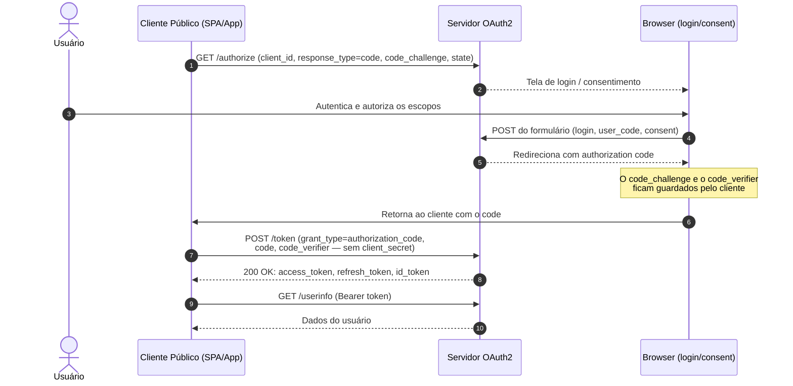

# Implantação do Método Public Clients (PKCE sem secret)

**Projeto:** `php-oauth` (`server/oauth2_complete.php` e `client/oauth2_client.php`)
**Documento:** Guia de implantação e verificação do fluxo para clientes públicos
**Status:** Rascunho — método ainda não implementado (ver `docs/ANALISE_METODOS_AUTENTICACAO.md`, seções 2.3 e 5.3)
**Depende de:** [Authorization Code + PKCE](./IMPLEMENTACAO_AUTHORIZATION_CODE_FLOW.md) — o PKCE já é suportado

---

## 1. Visão Geral

O fluxo **Public Clients (PKCE sem secret)** — também conhecido como *Authorization Code + PKCE* — é o padrão universal do OAuth 2.1 (BCP RFC 9700) para aplicações públicas, como SPAs em React/Angular e aplicativos mobile (iOS/Android/Flutter).

- **O que caracteriza um cliente público:** roda no ambiente do usuário (navegador ou dispositivo do usuário), portanto não pode guardar um `client_secret` — qualquer segredo embutido no cliente é recuperável pelo próprio usuário. Quando um segredo existe, ele existe para proteger contra uso não autorizado do client, nunca contra o usuário.
- **Como a segurança é mantida sem `client_secret`:** o cliente apenas se identifica (`client_id`) e inicia um fluxo de autorização no browser. Durante esse fluxo, o servidor emite um `code_challenge` derivado de um `code_verifier` que nunca sai do cliente; o verifier fica guardado até a troca do code. Assim, um interceptador do `authorization_code` não consegue usá-lo.
- **Requisito inegociável:** para clientes públicos, o **PKCE é obrigatório**. O servidor deve recusar qualquer autorização sem `code_challenge`, e exigir o `code_verifier` na troca do code.

Este documento descreve como implementar e implantar esse modo no projeto: o que já existe, o que falta, os pontos de integração no código, a configuração de um cliente público e os testes de verificação.

## 2. Estado Atual vs. Requisitos

### 2.1 O que já funciona (sem alterações)

| Item | Local | Descrição |
| :--- | :--- | :--- |
| Geração de `code_verifier` e `code_challenge` (S256) | `client/oauth2_client.php`, ~linha 962 | O verifier é aleatório (32 bytes) e permanece na sessão até o token; o challenge é enviado no authorize |
| Aceitação de `code_challenge` em `/authorize` | `server/oauth2_complete.php`, ~linha 403 | Valida o `code_challenge_method` (`S256` ou `plain`) e armazena o challenge junto ao code |
| Validação de `code_verifier` na troca do code | `server/oauth2_complete.php`, ~linha 993 | `verifyPkce()` recomputa o hash e compara com o verifier; falha retorna `invalid_grant` |
| Identificação por `client_id` em `/authorize` | `server/oauth2_complete.php`, ~linha 407 | Clientes são identificados por `client_id` sem exigir segredo na primeira etapa do fluxo |

### 2.2 O que falta implementar

| Item | Local | Problema atual |
| :--- | :--- | :--- |
| Detecção de cliente público | `$clients` (~linha 56) | Toda entrada define `client_secret`; não existe conceito de cliente público |
| Validação de segredo em `/token` | `server/oauth2_complete.php`, ~linha 941 | Compara `$client_secret` incondicionalmente; qualquer ausência retorna `invalid_client` |
| Fluxo `refresh_token` | `server/oauth2_complete.php`, ~linha 1225 | Mesma exigência de `client_secret` |
| Revogação (`/revoke`) e Introspecção (`/introspect`) | `server/oauth2_complete.php`, ~linha 1296 | Autenticação por `client_secret` obrigatória |
| Advertência de métodos no Discovery | `server/oauth2_complete.php`, ~linha 1382 | `token_endpoint_auth_methods_supported` não inclui `none` |

A análise original do gap está em [`docs/ANALISE_METODOS_AUTENTICACAO.md`](ANALISE_METODOS_AUTENTICACAO.md) (seções 2.3 e 5.3).

## 3. Fluxo Operacional

O diagrama a seguir mostra o fluxo completo com cliente público; o trecho final (troca do code) coincide com o fluxo Authorization Code já documentado.

Fluxo descrito nos detalhes:

1. O cliente público redireciona o usuário para o endpoint de *authorize*, informando `client_id`, `response_type=code`, `scope` e um `state` aleatório (proteção CSRF). Por se tratar de cliente público, **nunca envia `client_secret`** — esse segredo não existe para ele.
2. O usuário autentica no browser. O servidor emite um `code_challenge` (S256) e devolve ao cliente junto com o `code` final; o verifier correspondente permanece apenas na memória do cliente até a troca.
3. Ao receber o `code` no callback, o cliente envia `code_verifier` no endpoint de *token*, **sem nenhum `client_secret`**.
4. O servidor valida o verifier contra o challenge registrado e emite os tokens.

## 4. Requisitos Funcionais

### 4.1 Registro do cliente público

- A entrada em `$clients` deve permitir marcar o cliente como público. Dois modelos equivalentes são suportados: `'client_secret' => null` ou a flag `'public' => true`.
- Clientes públicos podem usar apenas os `grant_type`s permitidos para esse tipo (`authorization_code`, `refresh_token`, e `device_code` quando aplicável). Nunca inclua `grant_type=password` — ele exige `client_secret`.
- Clientes confidenciais (`client_secret` definido) mantêm todas as validações atuais, incluindo `client_secret_basic` e `client_secret_post` nos endpoints de token.

### 4.2 `/authorize` — exigir PKCE em clientes públicos

- Clientes públicos **devem enviar `code_challenge`** (obrigatório no OAuth 2.1). Se um cliente público autorizar sem challenge, o servidor deve recusar com `invalid_request`.
- Clientes confidenciais **podem** enviar `code_challenge` (opcional); quando o enviam, o método (`S256` ou `plain`) é validado como hoje.
- O `state` e o `nonce` continuam sendo validados normalmente — PKCE não substitui a proteção CSRF.

### 4.3 `/token` — dispensar o `client_secret`

- Para um cliente público, a comparação de `client_secret` deve ser **pulada**. O que valida o pedido é o próprio `client_id`.
- Quando o `authorization_code` foi emitido com `code_challenge`, o `code_verifier` é obrigatório — a validação existente (`verifyPkce`) já cobre isso. Um request sem verifier válido retorna `invalid_grant`.
- Clientes confidenciais: a verificação de `client_secret` permanece exigida, com as mesmas respostas atuais (`invalid_client` / HTTP 401).

### 4.4 Refresh Token — clientes públicos

- O refresh token é emitido junto com o access token e pertence a um único `client_id`. Por isso, o endpoint `grant_type=refresh_token` também dispensa a checagem de `client_secret` para clientes públicos — basta o `client_id` informado.
- Clientes confidenciais recebem a checagem exatamente como hoje.

### 4.5 Discovery — anunciar o suporte

- O endpoint OpenID Connect Discovery (`/well-known`) deve incluir `none` em `token_endpoint_auth_methods_supported` — e, por consequência, nos arrays de autenticação de revogação e introspecção — pois é o método usado por clientes públicos.
- O array `code_challenge_methods_supported` (`S256` e `plain`) já está correto e não muda.

### 4.6 Endpoints que exigem `client_secret` (decisão)

- Revogação (`/revoke`) e Introspecção (`/introspect`) são chamados por *Resource Servers*, que são clientes confidenciais por natureza. A checagem de `client_secret` permanece aí — clientes públicos não as utilizam, pois recebem apenas o access token Bearer.
- Nenhuma alteração é necessária além da checagem condicional já prevista para `/token`.

## 5. Integração com o Código Existente

Os trechos indicam o que já está pronto e o que precisa mudar. As numerações de linha referem-se a `server/oauth2_complete.php`.

**Já implementado — nenhuma alteração necessária:**

- `verifyPkce()` (~linha 240): valida o verifier contra o challenge, aceitando `S256` e `plain`; retorna `true` quando o code não usou PKCE.
- Geração do verifier no cliente (~linha 962): `base64UrlEncode(random_bytes(32))` e challenge SHA-256; o verifier fica armazenado até a troca do code.
- Validação do verifier na troca do code (~linha 993): retorna `invalid_grant` quando a verificação falha.
- O handler de `/authorize` já aceita `code_challenge` e valida o método, sem exigir segredo.

**A alterar:**

1. **`$clients` (~linha 56):** adicionar suporte ao modo público — `'public' => true` ou `'client_secret' => null` identifica o cliente; todo código que verifica segredo deve consultar esse indicador.
2. **`handleToken()` (~linha 941):** pular a comparação de `client_secret` apenas para clientes públicos; manter `invalid_client` (HTTP 401) para segredos inválidos de clientes confidenciais.
3. **`handleRefreshToken()` (~linha 1225):** idem, na checagem do `client_secret`.
4. **`handleRevoke()` e `handleIntrospect()` (~linha 1296):** idem, para consistência com as demais validações.
5. **`handleWellKnown()` (~linha 1382):** incluir `none` em `token_endpoint_auth_methods_supported` (e nos arrays de revogação e introspecção).

**Observação sobre o verifier:** hoje ele é guardado em `$_SESSION` (servidor do cliente). Para SPAs, deve permanecer apenas na memória durante o fluxo — nunca persistir em `localStorage` ou cookies, pois o servidor precisa rejeitar códigos trocados fora do fluxo.

## 6. Configuração de um Cliente Público

Para cadastrar um cliente público basta preencher os campos comuns e marcar publicidade:

| Campo | Valor para cliente público | Observação |
| :--- | :--- | :--- |
| `client_id` | Identificador único da aplicação | Usado em authorize e token |
| `client_name` | Nome exibido na tela de consentimento | Opcional |
| `redirect_uris` | URIs de callback autorizadas | Obrigatório; o usuário volta ao app por aqui |
| `grant_types` | `authorization_code`, `refresh_token` | Nunca inclua `password` |
| Indicativo de cliente público | `'public' => true` **ou** `'client_secret' => null` | Ponto central desta implantação |
| `token_endpoint_auth_method` | Mantém `client_secret_basic` | Clientes públicos não usam esse método |

> [!NOTE]
> Clientes confidenciais continuam cadastrados exatamente como hoje, com `client_secret` definido — nenhum cliente existente é afetado.

## 7. Testes de Verificação

Cenários para validar a implantação:

1. **Token sem segredo (sucesso esperado):** cliente público troca um `authorization_code` válido, enviando `client_id` e `code_verifier`, **sem enviar `client_secret`** → resposta `200` com access/refresh/id tokens.
2. **Verifier obrigatório:** cliente público recebeu um `code` emitido com challenge e tenta trocá-lo **sem `code_verifier`**, ou com verifier errado → resposta `invalid_grant` (HTTP 400).
3. **Cliente confidencial mantido protegido:** cliente com `client_secret` definido envia um segredo incorreto → resposta `invalid_client` (HTTP 401), comportamento inalterado.
4. **Refresh sem segredo:** token obtido por cliente público renova o access token via `grant_type=refresh_token`, sem `client_secret` → sucesso; cliente confidencial continua exigindo o segredo.
5. **Discovery atualizado:** `GET /well-known` retorna `token_endpoint_auth_methods_supported` contendo `none`.
6. **Integridade do fluxo:** um `code` emitido para um cliente não é consumido por outro cliente, mesmo enviando `code_verifier` válido.

## 8. Segurança e Boas Práticas

- **Por que este é o pior caso para um atacante:** o `client_secret` nunca foi secreto em um cliente público. A proteção real vem do PKCE: o `code` interceptado não pode ser trocado sem o verifier, que nunca sai do cliente.
- **`S256` obrigatório:** o método `plain` é aceito pela especificação por conveniência, mas `S256` é fortemente recomendado; clientes públicos devem sempre usar `S256`.
- **Verifier não persistente:** o `code_verifier` permanece apenas durante a troa do code. Armazená-lo em `localStorage`, cookies ou logs anula a proteção.
- **HTTPS obrigatório:** o fluxo envolve tokens na resposta a um redirect; sem HTTPS, o `code` e o verifier trafegam em texto claro.
- **Não logar o verifier:** o valor de `code_verifier` é sensível e não deve aparecer em logs de aplicação, proxies ou DevTools do servidor.
- **Estado e nonce seguem valendo:** PKCE protege contra interceptação do code; `state` continua protegendo contra CSRF e `nonce` contra replay da resposta.

## 9. Referências

- [RFC 6749 — OAuth 2.0 Framework](https://tools.ietf.org/html/rfc6749) — base do fluxo Authorization Code
- [RFC 7636 — PKCE (Proof Key for Code Exchange)](https://tools.ietf.org/html/rfc7636) — PKCE e `code_verifier`
- [RFC 9700 / BCP — OAuth 2.0 Security Best Current Practice](https://datatracker.ietf.org/doc/html/rfc9700) — PKCE é o padrão; flows baseados em segredo são descontinuados
- [`docs/ANALISE_METODOS_AUTENTICACAO.md`](ANALISE_METODOS_AUTENTICACAO.md) — matriz de métodos e plano do gap (seções 2.3 e 5.3)
- [`docs/IMPLEMENTACAO_AUTHORIZATION_CODE_FLOW.md`](IMPLEMENTACAO_AUTHORIZATION_CODE_FLOW.md) — estado do fluxo Authorization Code + PKCE
