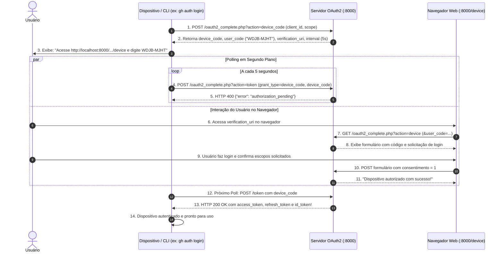

# Plano: Device Authorization Grant (RFC 8628 - Device Flow)

**Projeto:** `php-oauth`  
**Escopo:** `server/oauth2_complete.php`, `client/oauth2_client.php`, `client/device_cli.php`  
**Status:** Planejamento Aprovado para Execução Futura  
**Data:** 12 de Outubro de 2026  

---

## 1. Visão Geral

O **Device Authorization Grant** (definido formalmente na **RFC 8628**) foi desenvolvido para clientes executados em dispositivos sem navegador embutido ou com capacidade de entrada de texto severamente restrita.

### Exemplos no Mercado Real
* **Ferramentas de Linha de Comando (CLIs):** `gh auth login` (GitHub CLI), `aws login`, `gcloud auth login` (Google Cloud SDK), `docker login`, `vercel login`, `supabase login`, `stripe login`.
* **Smart TVs e Entretenimento:** YouTube na TV, Netflix, Spotify Connect, consoles de videogame (PlayStation, Xbox), Apple TV.

---

## 2. Arquitetura do Fluxo



---

## 3. Especificação dos Endpoints

### 3.1 Endpoint de Autorização do Dispositivo
* **Rota:** `POST /oauth2_complete.php?action=device_code`
* **Parâmetros:**
  * `client_id` (obrigatório): ex. `cliente_teste`
  * `scope` (opcional): ex. `openid profile email`
* **Resposta de Sucesso (HTTP 200):**
  ```json
  {
    "device_code": "4f9a8b1c2d3e...",
    "user_code": "BCDF-GHJK",
    "verification_uri": "http://localhost:8000/oauth2_complete.php?action=device",
    "verification_uri_complete": "http://localhost:8000/oauth2_complete.php?action=device&user_code=BCDF-GHJK",
    "expires_in": 600,
    "interval": 5
  }
  ```

### 3.2 Endpoint de Interação com o Usuário
* **Rota:** `GET / POST /oauth2_complete.php?action=device`
* **GET:**
  * Renderiza tela para entrada do `user_code` (preenchido automaticamente via `?user_code=...`).
  * Autentica o usuário caso não haja sessão ativa (`$_SESSION['oauth_authenticated_user']`).
  * Exibe tela de consentimento dos escopos solicitados.
* **POST:**
  * Processa a decisão do usuário:
    * `consent = 1`: marca o registro no storage como `approved`, atribuindo o usuário e escopos concedidos.
    * `consent = 0`: marca como `denied`.

### 3.3 Endpoint de Token (Polling)
* **Rota:** `POST /oauth2_complete.php?action=token`
* **Parâmetros:**
  * `grant_type`: `urn:ietf:params:oauth:grant-type:device_code` (ou alias `device_code`)
  * `device_code`: código recebido no passo 3.1
  * `client_id`: ID do cliente
  * `client_secret`: segredo do cliente (quando confidencial)
* **Respostas Possíveis:**
  * **Pendente:** HTTP 400 `{"error": "authorization_pending"}`
  * **Polling Rápido:** HTTP 400 `{"error": "slow_down"}` (intervalo incrementado em +5s)
  * **Expirado:** HTTP 400 `{"error": "expired_token"}`
  * **Recusado:** HTTP 400 `{"error": "access_denied"}`
  * **Aprovado:** HTTP 200 com `access_token`, `refresh_token`, `id_token`, etc.

---

## 4. Estrutura de Armazenamento (`$storage['device_codes']`)

```json
{
  "device_codes": {
    "4f9a8b1c2d3e...": {
      "device_code": "4f9a8b1c2d3e...",
      "user_code": "BCDF-GHJK",
      "client_id": "cliente_teste",
      "scope": "openid profile email",
      "status": "pending",
      "username": null,
      "created_at": 1728765000,
      "expires_at": 1728765600,
      "interval": 5,
      "last_poll": 0
    }
  }
}
```

---

## 5. Módulos a Implementar no Código

1. **`server/oauth2_complete.php`:**
   * Constantes/configurações: tempo de expiração do código (600s) e intervalo de polling (5s).
   * Função `generateUserCode()`: gera strings de 8 caracteres alfanuméricos legíveis (`XXXX-XXXX`) sem ambiguidades.
   * Função `handleDeviceAuthorization()`: emissão de códigos.
   * Função `handleDevice()`: tela web de aprovação do usuário.
   * Extensão de `handleToken()`: processamento do `grant_type=device_code`.
   * Atualização de `handleWellKnown()` e `handleDebug()`.

2. **`client/oauth2_client.php`:**
   * Nova aba **"📺 Device Flow (CLI / TV)"** com simulação visual de terminal e polling assíncrono via JavaScript.

3. **`client/device_cli.php` (Novo Utilitário):**
   * Script CLI independente para execução no terminal Linux:
     ```bash
     php client/device_cli.php
     ```
   * Simula em tempo real uma ferramenta de linha de comando como o `gh auth login`.

---

## 6. Procedimento de Testes e Validação

```bash
# 1. Obter código do dispositivo
curl -s -X POST "http://localhost:8000/oauth2_complete.php?action=device_code" \
  -d "client_id=cliente_teste" \
  -d "scope=openid profile email"

# 2. Testar polling com status pendente
curl -s -X POST "http://localhost:8000/oauth2_complete.php?action=token" \
  -d "client_id=cliente_teste" \
  -d "client_secret=senha_secreta_123" \
  -d "grant_type=urn:ietf:params:oauth:grant-type:device_code" \
  -d "device_code=SEU_DEVICE_CODE"
# Resposta esperada: HTTP 400 {"error": "authorization_pending"}

# 3. Testar no terminal com o script CLI
php client/device_cli.php
```

