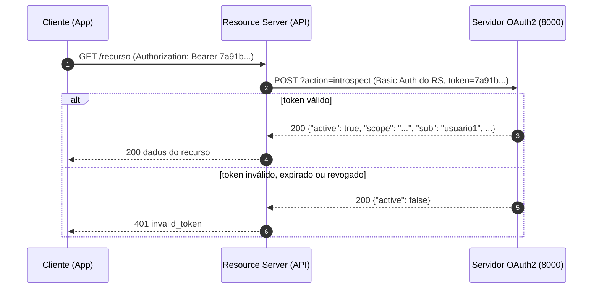

# Token Introspection (RFC 7662) — Guia de Implementação

**Projeto:** `php-oauth` (`server/oauth2_complete.php`)
**Status:** Especificação. Ainda não implementado.
**Referência:** [RFC 7662 — OAuth 2.0 Token Introspection](https://datatracker.ietf.org/doc/html/rfc7662)

---

## 1. Objetivo

Criar o endpoint `?action=introspect`, que permite a um **Resource Server** (uma API protegida) perguntar ao servidor de autorização se um token ainda é válido e quais são seus metadados.

O projeto emite **access tokens opacos** (`bin2hex(random_bytes(32))`), sem informação embutida. Por isso uma API externa não consegue validá-los sozinha e precisa consultar o servidor.



---

## 2. Princípio da Implementação

> [!IMPORTANT]
> A implementação é **somente aditiva**. Nenhuma função existente (`handleToken`, `handleRevoke`, `handleUserInfo` etc.) é alterada. O endpoint novo tem sua própria autenticação de cliente, seguindo o mesmo padrão que o `handleRevoke` já usa.

O endpoint só **lê** o storage. Ele não apaga tokens expirados nem altera nenhum dado.

---

## 3. Dados Já Disponíveis no Storage

O `handleToken` já grava tudo o que a introspecção precisa:

```php
// $storage['access_tokens'][<token>]  e  $storage['refresh_tokens'][<token>]
[
    'client_id'  => 'cliente_teste',
    'username'   => 'usuario1',        // no client_credentials, vale o próprio client_id
    'scope'      => 'openid profile',
    'created_at' => 1791996400,
    'expires_at' => 1792000000,
]
```

Mapeamento para a resposta da RFC 7662:

| Campo no storage | Campo na resposta | Observação |
| :--- | :--- | :--- |
| *(token encontrado e não expirado)* | `active` | `true` / `false` |
| `scope` | `scope` | |
| `client_id` | `client_id` | |
| `username` | `sub` | Sempre presente |
| `username` | `username` | Omitido quando `username === client_id` (Client Credentials, sem usuário final) |
| `expires_at` | `exp` | Unix timestamp |
| `created_at` | `iat` | Unix timestamp |
| *(bucket)* | `token_type` | `Bearer` para access token, `refresh_token` para refresh token |
| `$config['base_url']` | `iss` | |

---

## 4. Especificação do Endpoint

### 4.1 Requisição

```http
POST /oauth2_complete.php?action=introspect HTTP/1.1
Host: localhost:8000
Authorization: Basic base64(api_recursos:segredo_api_456)
Content-Type: application/x-www-form-urlencoded

token=7a91b...&token_type_hint=access_token
```

| Parâmetro | Obrigatório | Descrição |
| :--- | :---: | :--- |
| `token` | ✅ | Token a ser inspecionado |
| `token_type_hint` | ❌ | `access_token` ou `refresh_token`. Só define **a ordem** da busca |
| `client_id` + `client_secret` | ⚠️ | Alternativa ao Basic Auth (`client_secret_post`) |

### 4.2 Respostas

| Situação | HTTP | Corpo |
| :--- | :---: | :--- |
| Método diferente de POST | 405 | `{"error": "invalid_request"}` |
| Credenciais do cliente ausentes ou inválidas | 401 | `{"error": "invalid_client"}` + header `WWW-Authenticate` |
| Parâmetro `token` ausente | 400 | `{"error": "invalid_request", "error_description": "token ausente"}` |
| Token inexistente, expirado ou revogado | **200** | `{"active": false}` (**nenhum outro campo**, RFC 7662 §2.2) |
| Token ativo | 200 | Objeto completo (abaixo) |

Token ativo de usuário:
```json
{
  "active": true,
  "scope": "openid profile email",
  "client_id": "cliente_teste",
  "username": "usuario1",
  "sub": "usuario1",
  "token_type": "Bearer",
  "exp": 1792000000,
  "iat": 1791996400,
  "iss": "http://localhost:8000"
}
```

Token ativo de Client Credentials (sem `username`):
```json
{
  "active": true,
  "scope": "openid profile",
  "client_id": "cliente_teste",
  "sub": "cliente_teste",
  "token_type": "Bearer",
  "exp": 1792000000,
  "iat": 1791996400,
  "iss": "http://localhost:8000"
}
```

Todas as respostas devem incluir `Cache-Control: no-store` e `Pragma: no-cache` (RFC 7662 §4).

### 4.3 Política de Acesso

Qualquer cliente cadastrado e autenticado pode introspectar qualquer token. Esse é o comportamento esperado de um Resource Server, que normalmente **não** é o cliente que obteve o token. Por isso o guia cadastra um cliente dedicado para a API (passo 5.1).

---

## 5. Passo a Passo da Implementação

Todas as alterações são em `server/oauth2_complete.php`.

### 5.1 Cadastrar o Resource Server em `$clients`

Adicionar uma nova entrada ao array `$clients`, depois de `cliente_teste`:

```php
    'api_recursos' => [
        'client_id' => 'api_recursos',
        'client_secret' => 'segredo_api_456',
        'client_name' => 'API de Recursos (Resource Server)',
        'redirect_uris' => [],
        'response_types' => [],
        'grant_types' => [],          // não obtém tokens, apenas introspecta
        'token_endpoint_auth_method' => 'client_secret_basic',
    ],
```

> [!NOTE]
> A página de debug percorre `grant_types`, `response_types` e `redirect_uris` com `foreach`. Arrays vazios funcionam e só deixam as células em branco.

### 5.2 Criar a função `handleIntrospect()`

Inserir uma nova seção logo depois de `handleRevoke()` (antes da seção `WELL-KNOWN`):

```php
// ============================================================================
// AÇÃO: INTROSPECT (RFC 7662 - Token Introspection)
// ============================================================================

function handleIntrospect() {
    global $clients, $config;

    // RFC 7662 §4: respostas de introspecção não devem ser cacheadas
    header('Cache-Control: no-store');
    header('Pragma: no-cache');

    if ($_SERVER['REQUEST_METHOD'] !== 'POST') {
        return jsonResponse(['error' => 'invalid_request'], 405);
    }

    // Autenticação do Resource Server (client_secret_post ou client_secret_basic)
    $client_id = $_POST['client_id'] ?? null;
    $client_secret = $_POST['client_secret'] ?? null;

    $auth_header = getAuthorizationHeader();
    if ($auth_header && strpos($auth_header, 'Basic ') === 0) {
        $credentials = base64_decode(substr($auth_header, 6));
        if (strpos($credentials, ':') !== false) {
            list($client_id, $client_secret) = explode(':', $credentials, 2);
        }
    }

    if (!$client_id || !isset($clients[$client_id])
        || !hash_equals((string) $clients[$client_id]['client_secret'], (string) $client_secret)) {
        header('WWW-Authenticate: Basic realm="oauth2"');
        return jsonResponse(['error' => 'invalid_client'], 401);
    }

    $token = $_POST['token'] ?? null;
    if (!$token) {
        return jsonResponse(['error' => 'invalid_request', 'error_description' => 'token ausente'], 400);
    }

    // O hint só define a ordem da busca; se não achar, procura no outro tipo (RFC 7662 §2.1)
    $buckets = ['access_tokens', 'refresh_tokens'];
    if (($_POST['token_type_hint'] ?? null) === 'refresh_token') {
        $buckets = ['refresh_tokens', 'access_tokens'];
    }

    $storage = loadStorage();

    foreach ($buckets as $bucket) {
        if (!isset($storage[$bucket][$token])) {
            continue;
        }

        $data = $storage[$bucket][$token];

        // Expirado → inativo (somente leitura: não remove do storage)
        if (time() > ($data['expires_at'] ?? 0)) {
            return jsonResponse(['active' => false]);
        }

        $response = [
            'active'     => true,
            'scope'      => $data['scope'],
            'client_id'  => $data['client_id'],
            'sub'        => $data['username'],
            'token_type' => $bucket === 'refresh_tokens' ? 'refresh_token' : 'Bearer',
            'exp'        => $data['expires_at'],
            'iat'        => $data['created_at'],
            'iss'        => $config['base_url'],
        ];

        // Client Credentials grava username = client_id; nesse caso não há usuário final
        if ($data['username'] !== $data['client_id']) {
            $response['username'] = $data['username'];
        }

        return jsonResponse($response);
    }

    // Token desconhecido ou revogado
    return jsonResponse(['active' => false]);
}
```

> [!NOTE]
> Usa `hash_equals` na comparação do secret para evitar timing attacks. Isso vale só para a função nova e não muda os endpoints existentes.

### 5.3 Registrar a rota

No `switch ($action)` do roteador, adicionar o case depois de `revoke`:

```diff
     case 'revoke':
         handleRevoke();
         break;
+    case 'introspect':
+        handleIntrospect();
+        break;
     case 'well-known':
```

### 5.4 Anunciar no Discovery

No array retornado por `handleWellKnown()`, adicionar duas chaves:

```diff
         'revocation_endpoint' => $base . '?action=revoke',
+        'introspection_endpoint' => $base . '?action=introspect',
```

```diff
         'revocation_endpoint_auth_methods_supported' => ['client_secret_basic', 'client_secret_post'],
+        'introspection_endpoint_auth_methods_supported' => ['client_secret_basic', 'client_secret_post'],
```

### 5.5 (Opcional) Documentar na página de Debug

Em `handleDebug()`, na seção "🔗 Endpoints & Grant Types", depois do bloco de *Client Credentials*:

```html
<h3 style="color: #333; margin-top: 1.5rem; margin-bottom: 0.5rem;">Token Introspection (RFC 7662):</h3>
<div class="endpoint">
    <strong>POST /introspect (com Basic Auth do Resource Server)</strong>
    <code>token=ACCESS_TOKEN&amp;token_type_hint=access_token</code>
    <p style="margin-top: 0.5rem; font-size: 0.8rem; color: #666;">Header: Authorization: Basic base64(api_recursos:segredo_api_456)</p>
</div>
```

---

## 6. Resumo das Alterações

| # | Local em `oauth2_complete.php` | Tipo | Descrição |
| :-: | :--- | :--- | :--- |
| 1 | Array `$clients` | Adição | Cliente `api_recursos` |
| 2 | Após `handleRevoke()` | Adição | Função `handleIntrospect()` |
| 3 | Roteador `switch ($action)` | Adição | `case 'introspect'` |
| 4 | `handleWellKnown()` | Adição | `introspection_endpoint` + métodos de auth |
| 5 | `handleDebug()` | Adição (opcional) | Bloco de documentação do endpoint |

---

## 7. Plano de Verificação

### 7.1 Preparação

```powershell
php -l server/oauth2_complete.php
php -S localhost:8000 -t server

# Obter um access token (Client Credentials)
curl.exe -s -u cliente_teste:senha_secreta_123 -d "grant_type=client_credentials&scope=openid profile" "http://localhost:8000/oauth2_complete.php?action=token"

# Obter access + refresh token de usuário (Password Grant)
curl.exe -s -u cliente_teste:senha_secreta_123 -d "grant_type=password&username=usuario1&password=senha123&scope=openid profile" "http://localhost:8000/oauth2_complete.php?action=token"
```

Introspecção:
```powershell
curl.exe -i -u api_recursos:segredo_api_456 -d "token=<TOKEN>" "http://localhost:8000/oauth2_complete.php?action=introspect"
```

### 7.2 Cenários

| # | Cenário | Como testar | Resultado esperado |
| :-: | :--- | :--- | :--- |
| 1 | Access token de Client Credentials | `token=<AT>` | 200, `active: true`, `sub: cliente_teste`, **sem** `username` |
| 2 | Access token de usuário | `token=<AT usuario1>` | `active: true`, `username` e `sub` = `usuario1` |
| 3 | Refresh token com hint | `token=<RT>&token_type_hint=refresh_token` | `active: true`, `token_type: refresh_token` |
| 4 | Refresh token com hint errado | `token=<RT>&token_type_hint=access_token` | Ainda encontra, `active: true` |
| 5 | Token inexistente | `token=abc123` | 200, apenas `{"active": false}` |
| 6 | Token revogado | Chamar `action=revoke` antes | `{"active": false}` |
| 7 | Token expirado | Editar `expires_at` no arquivo de storage para o passado | `{"active": false}` |
| 8 | Sem credenciais | Remover `-u` | 401 `invalid_client` + `WWW-Authenticate` |
| 9 | Secret incorreto | `-u api_recursos:errado` | 401 `invalid_client` |
| 10 | Método GET | `curl.exe -X GET ...` | 405 |
| 11 | Sem parâmetro `token` | `-d ""` | 400 `invalid_request` |
| 12 | `client_secret_post` | `-d "client_id=api_recursos&client_secret=segredo_api_456&token=<AT>"` | Igual ao cenário 1 |
| 13 | Headers de cache | Conferir saída de `-i` | `Cache-Control: no-store` |
| 14 | Discovery | `?action=well-known` | Contém `introspection_endpoint` |
| 15 | Regressão | Executar `token`, `revoke`, `userinfo` | Comportamento inalterado |
